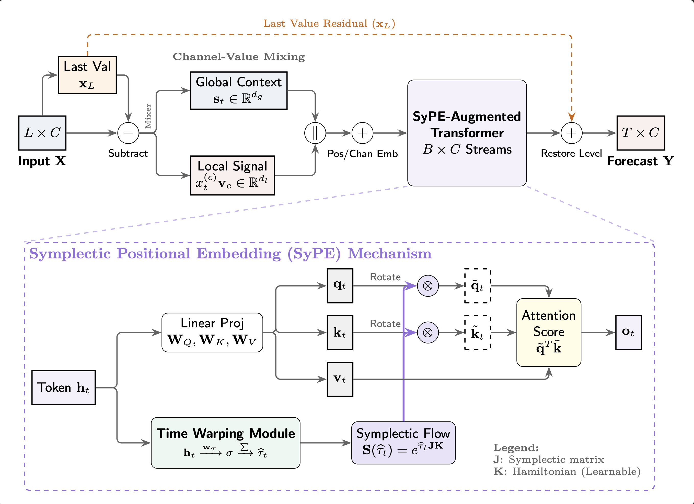

# StretchTime: Adaptive Time Series Forecasting via Symplectic Attention

This repository hosts the code for our paper: "StretchTime: Adaptive Time Series Forecasting via Symplectic Attention"

The main model can be found in `models/StretchTime.py`

## 1. Install Required Packages

Install PyTorch first, then install the additional dependencies with:

```bash
pip install -r requirements.txt
```

## 2. Download Datasets

You can download the datasets used in the paper from the link provided by the iTransformer or Time-Series-Library githubs. Place the downloaded files in `dataset/`.

## 3. Run the Training Scripts

To train the StretchTime model, run:

```bash
bash stretchtime.sh
```

## 4. Overall Architecture



## 5. Monitoring

Metrics are logged to Weights & Biases.
